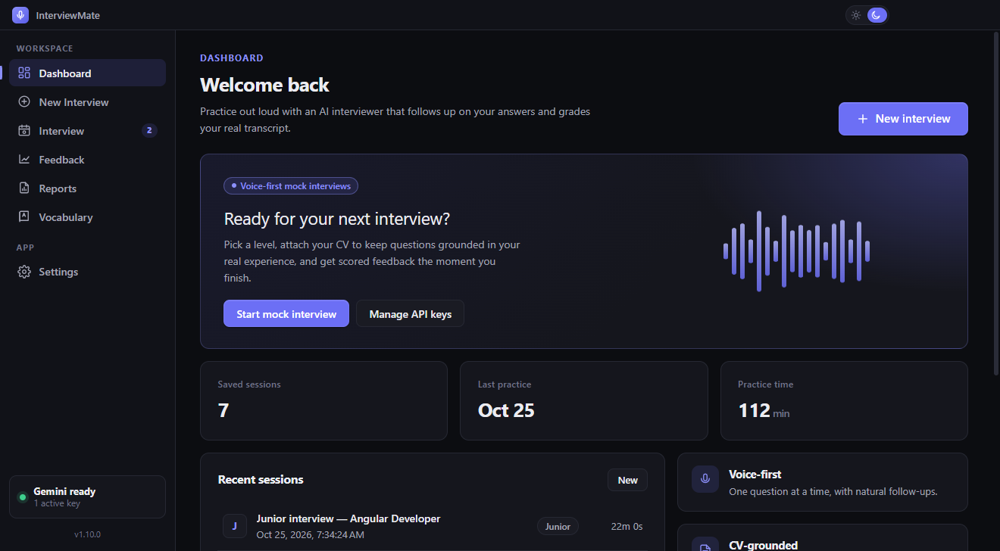
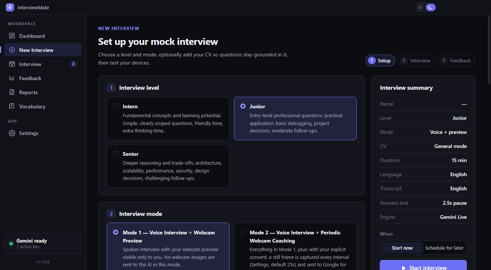
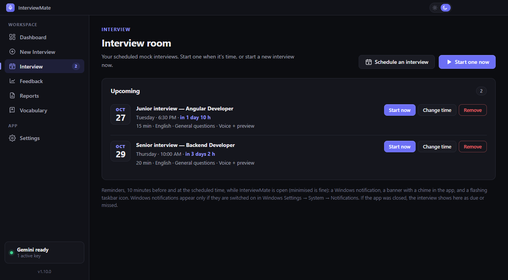
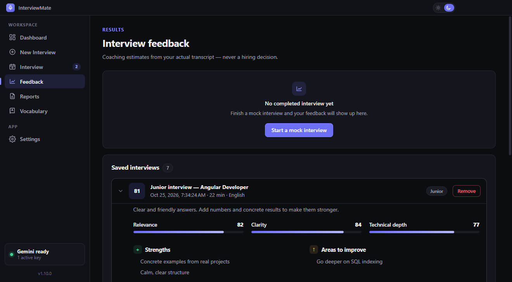
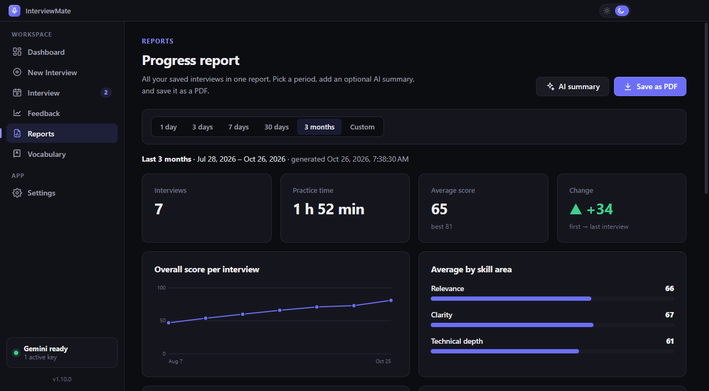
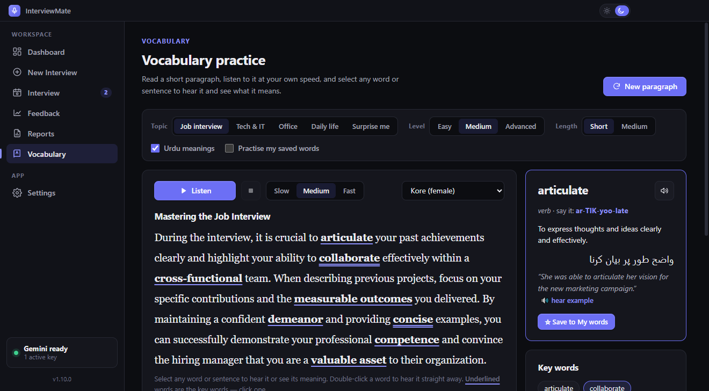

# InterviewMate

**Practise job interviews out loud with an AI interviewer, then see exactly what to improve.**

InterviewMate is a Windows desktop app. It runs a spoken mock interview with a Google Gemini interviewer. The interviewer listens to your answers, asks natural follow-up questions, and grades your real transcript at the end. It also has progress reports, a scheduler with reminders, and an English vocabulary trainer with read-aloud and meanings.

It is **local-first**: no account, no cloud backend, no subscription. You bring a free Google AI Studio API key, and everything else (sessions, scores, saved words, your schedule) stays in files on your own computer.



> Screenshots in this repo use **sample data**, not real interviews.

---

## Why this exists

Most interview preparation is silent: reading lists of questions, or typing answers into a chat box. Real interviews are different:

- **You have to speak.** You think on your feet, fill silences, and get your point across in one go.
- **The interviewer reacts.** A follow-up question about something you just said is what exposes a weak answer.
- **Nobody tells you afterwards** what went wrong, or whether you are getting better.

InterviewMate was built to close those gaps for one person preparing for developer interviews, with free tools only:

| Problem | How InterviewMate helps |
|---|---|
| Practising alone feels unrealistic | A named interviewer greets you like a real call, asks one question at a time and follows up on your answers by voice. |
| Generic questions don't match your experience | Attach your CV (PDF/DOCX). Questions stay grounded in the skills and projects it actually lists. |
| You don't know what went wrong | Feedback from your real transcript: scores for relevance, clarity and technical depth, strengths, areas to improve and practice questions. |
| You can't tell if you're improving | Reports combine interviews over 1 day to 3 months (or a custom range) with trends, averages and an optional AI coaching summary, and export to PDF. |
| You skip practice | Schedule interviews for an exact date and time, with reminders. |
| English vocabulary holds you back | A Vocabulary tab writes practice paragraphs, reads them aloud at three speeds, highlights each sentence as it is read, and explains any word or sentence you select (optionally in Urdu). |
| Paid tools and privacy worries | Free Gemini models only by default; keys are encrypted with Windows secure storage; no audio or video is recorded; data stays on your PC. |

---

## Features at a glance

| | Feature | What it does |
|---|---|---|
| 🎙️ | **Voice mock interviews** | Real-time spoken interview with Gemini Live. Intern, Junior or Senior level; 10–30 minutes; English or Urdu. |
| 📄 | **CV-grounded questions** | Your CV is read on your computer; questions only reference what it contains. |
| 📷 | **Webcam preview and coaching** | Mode 1 shows your camera only to you. Mode 2 (opt-in) sends a still every 25 s for tips on framing, lighting and eye contact. Blur, colour or image backgrounds. Draggable picture-in-picture. |
| ⏸️ | **You control when an answer ends** | Automatic mode waits for a pause you choose (1.5 s, 2.5 s or 4 s). Manual mode waits for **Done answering**. **Space** or **Enter** sends your answer immediately. |
| 🗂️ | **Interview tab and scheduling** | The interview keeps running when you switch tabs. Schedule interviews for later, with reminders 10 minutes before and on time. |
| 📊 | **Feedback** | Scores, strengths, improvements and practice questions from your transcript. Translated transcript (English / اردو). Saved history. |
| 📈 | **Reports and PDF** | Progress over a period, with KPI tiles, trend chart, skill averages, AI summary and A4 PDF export. |
| 📚 | **Vocabulary trainer** | AI paragraphs with key words, read-aloud at Slow, Medium or Fast speed, sentence highlighting, select-to-explain, Urdu meanings and a saved word list. |
| 🔑 | **Multiple API keys and failover** | Add several keys; when one runs out of quota, the app moves to the next. |
| 🌗 | **Light and dark theme** | Remembered between launches. |

Full details, including how each feature works and why it is built that way, are in **[docs/FEATURES.md](docs/FEATURES.md)**.

<table>
<tr>
<td></td>
<td></td>
</tr>
<tr>
<td></td>
<td></td>
</tr>
<tr>
<td colspan="2"></td>
</tr>
</table>

---

## Download and run (Windows)

1. Open **[Releases](../../releases)** and download the latest `InterviewMate-Windows-Portable-<version>.zip`.
2. Unzip it anywhere, for example `Documents\InterviewMate`.
3. Run `InterviewMate.exe`. No installation is needed. Windows SmartScreen may warn because the app is not code-signed: choose **More info → Run anyway**.
4. In **Settings**, add a free API key from [Google AI Studio](https://aistudio.google.com/apikey).
5. Open **New Interview**, choose a level, and press **Start interview**.

Step-by-step instructions are in the **[User guide](docs/USER_GUIDE.md)**.

Every version from v1.1.0 to v1.10.0 is published as its own release, so you can go back to an older build if you need to. What changed in each one is in **[CHANGELOG.md](CHANGELOG.md)**.

---

## How it works (short version)

```text
┌────────────────────────── InterviewMate (Electron) ──────────────────────────┐
│                                                                              │
│  Angular UI (renderer, sandboxed)      preload.cjs       Main process        │
│  ─────────────────────────────────    ─────────────     ──────────────────   │
│  Setup · Interview · Feedback ·  ◄──► narrow, typed ◄──► API keys (encrypted)│
│  Reports · Vocabulary · Settings       IPC bridge        Gemini REST calls   │
│        │                                                 JSON files on disk  │
│        │ short-lived token only                          reminders, PDF      │
└────────┼─────────────────────────────────────────────────────────┼───────────┘
         ▼                                                         ▼
   Gemini Live API (voice, WebSocket)              Gemini text / TTS / vision API
```

- Your API key never reaches the web page. The main process mints a single-use, short-lived token for the voice session.
- Feedback, translations, reports, vocabulary and speech go through the main process, which falls back across free models and keys.
- All data is saved as JSON in `%APPDATA%\interviewmate`.

The full explanation is in **[docs/ARCHITECTURE.md](docs/ARCHITECTURE.md)**.

---

## Documentation

| Document | Read it for |
|---|---|
| [docs/FEATURES.md](docs/FEATURES.md) | What every feature does, how it works and why it helps |
| [docs/USER_GUIDE.md](docs/USER_GUIDE.md) | Install, first run, API keys, your first interview, troubleshooting |
| [docs/ARCHITECTURE.md](docs/ARCHITECTURE.md) | Electron/Angular structure, IPC, Gemini models and fallback, storage |
| [docs/PRIVACY_AND_SECURITY.md](docs/PRIVACY_AND_SECURITY.md) | What is stored, what is sent to Google, and how keys are protected |
| [docs/DEVELOPMENT.md](docs/DEVELOPMENT.md) | Build from source, run tests, package a release |
| [CHANGELOG.md](CHANGELOG.md) | Version history v1.1.0 to v1.10.0 |
| [docs/history/](docs/history/) | Original build reports from the first versions |

---

## Built with

Electron 45 · Angular 22 (standalone components, signals) · TypeScript · SCSS · Google Gemini (Live, text, TTS, vision) via `@google/genai` and REST · pdf.js and mammoth (CV reading) · MediaPipe selfie segmentation (camera backgrounds) · electron-builder.

## Project status

This is a personal learning project, built and used by one person on Windows 10/11. It is not affiliated with Google. Gemini free-tier limits apply, and Google may use free-tier content to improve its products (see [Privacy and security](docs/PRIVACY_AND_SECURITY.md)).

## Licence

Released under the [MIT License](LICENSE). You are free to use, change and share the code, as long as the copyright notice stays with it.
